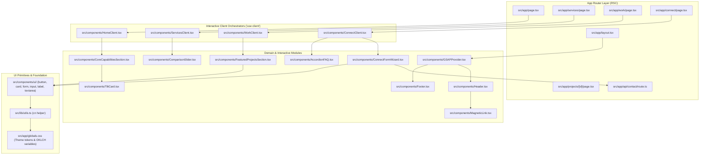

# Architecture

**Architecture Mapping Date:** 2026-10-18  
**Repository:** `AstronautGuy/DevfinityFrontend`  
**Root Path:** `e:\work\DevfinityFrontend`

---

## 1. System Overview

DevfinityFrontend is built on **Next.js 16 App Router** and **React 19**, styled with **Tailwind CSS v4** and animated using **GSAP (GreenSock)**. The application serves as both a high-performance marketing and showcase platform for enterprise software development and an interactive system intake portal.

The codebase adheres to a decoupled architecture separating **Server-Rendered Route Boundaries** from **Rich Interactive Client Orchestrators**, guaranteeing search-engine crawlability (via Next.js static metadata and JSON-LD schemas) while delivering hardware-accelerated interactive web performance.

---

## 2. Key Architectural Layers

---

## 3. Core Architectural Patterns

### 1. Server Component / Client Orchestrator Separation
- Every page entrypoint (`src/app/**/page.tsx`) functions as an RSC (React Server Component).
- RSCs define and export Next.js `metadata` (title, description, OpenGraph, JSON-LD) for strict SEO performance.
- The RSC directly renders a corresponding client component (`HomeClient`, `ServicesClient`, `WorkClient`, `ConnectClient`).
- This isolates the `'use client'` directive and heavy animation bundles to client component sub-trees, keeping initial HTML payloads lightweight.

### 2. GSAP Lifecycle & Context Isolation
- **Global Provider:** [`src/components/GSAPProvider.tsx`](file:///e:/work/DevfinityFrontend/src/components/GSAPProvider.tsx) executes a top-level `useLayoutEffect` to configure `ScrollTrigger` and register the `useGSAP` plugin.
- **Scoped Timelines:** Components utilize `@gsap/react`'s `useGSAP` hook with explicit ref scoping (e.g. `{ scope: containerRef }`), guaranteeing that DOM node queries are scoped locally and automatically killed on component unmount to prevent memory leaks.
- **Context-Safe Event Listeners:** User mouse interactions in [`src/components/MagneticLink.tsx`](file:///e:/work/DevfinityFrontend/src/components/MagneticLink.tsx) and [`src/components/TiltCard.tsx`](file:///e:/work/DevfinityFrontend/src/components/TiltCard.tsx) wrap animation triggers in `contextSafe(...)` for clean garbage collection.

### 3. Progressive Multi-Step State Flow
- [`src/components/ConnectFormWizard.tsx`](file:///e:/work/DevfinityFrontend/src/components/ConnectFormWizard.tsx) implements a 4-step intake pipeline: Identity, Operational Scope, System Capacity, and Core Briefing.
- Horizontal track sliding is driven via GSAP transforms (`gsap.to(".wizard-track", { xPercent: -25 * step })`).
- Form submission sends validated JSON to [`src/app/api/contact/route.ts`](file:///e:/work/DevfinityFrontend/src/app/api/contact/route.ts), returning error details or success messages without full page reloads.

### 4. Dynamic & Horizontal Layouts
- **Horizontal Scroll Hijack:** [`src/components/FeaturedProjectsSection.tsx`](file:///e:/work/DevfinityFrontend/src/components/FeaturedProjectsSection.tsx) pins the section on scroll and interpolates `xPercent` over the container's width, transforming standard vertical scrolling into a smooth horizontal panel viewer.
- **Pinned Interactive Viewports:** [`src/components/HomeClient.tsx`](file:///e:/work/DevfinityFrontend/src/components/HomeClient.tsx) and [`src/components/ServicesClient.tsx`](file:///e:/work/DevfinityFrontend/src/components/ServicesClient.tsx) use pinned timelines to orchestrate scale transforms, row highlighting, and SVG timeline fills as the user scrolls.
